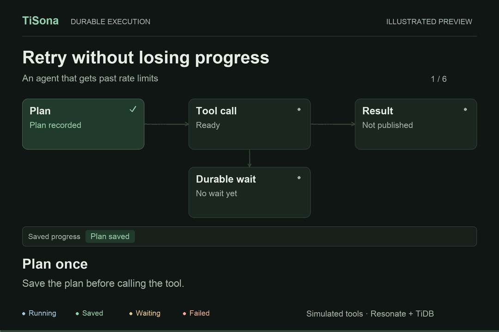
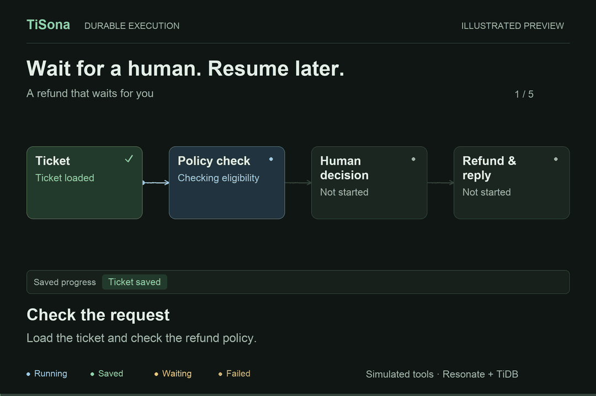
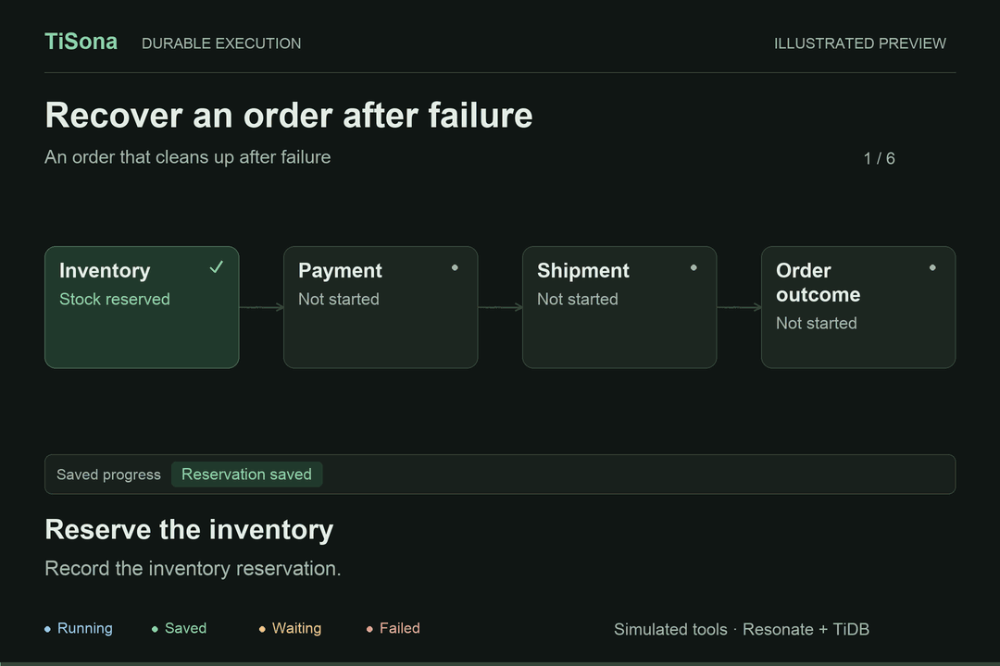

# TiSona — durable execution for agents

Powered by **Resonate** and **TiDB**. The local preview uses TiDB Cloud Zero.

[Production runbook](PRODUCTION.md) · [Examples](EXAMPLES.md)

A runnable **single-project durable execution service**. Application workers
run as separate processes in the customer's environment. This service owns
the endpoint, durable state, function catalogue, asynchronous API, credentials,
and browser session. It reuses the existing Resonate MySQL engine, TypeScript
SDK, HTTP/SSE transport, and execution read model without modifying them. Its
Web Console runs as an independent frontend and uses the backend REST API.
It does not embed or load the upstream Console.

## See it work

These illustrated previews follow the bundled example flows. Business tools
are simulated; running the examples locally uses real Resonate executions
with progress persisted in TiDB.

**Retry a failed tool. Keep the saved plan.** Two rate limits trigger durable
waits before a successful third attempt. The completed plan stays saved.



<details>
<summary><strong>Human approval: wait for a decision, then resume</strong></summary>

The refund waits for approval. Saved policy checks and the pending decision
survive a worker going offline; the refund happens after approval.



</details>

<details>
<summary><strong>Order compensation: recover after shipping fails</strong></summary>

After a shipping failure, the workflow records a payment refund and releases
inventory. The failure and both recovery actions remain visible.



</details>

To try these flows, follow **Start** below, run `npm run worker:examples` in
another terminal, and open **Overview** or **Examples**. The Console's live
animation follows saved execution state. [Animation source and rebuild instructions](docs/animations/README.md).

## Start

Requires Node.js 22+, npm, Git, Rust/Cargo, and network access. No TiDB account,
manually supplied database password, model API key, Docker, or Kubernetes is
required. Cloud Zero provisions a temporary database automatically.

Clone this repository and run from its root:

```sh
git clone https://github.com/siddontang/tisona.git
cd tisona
npm ci
npm run bootstrap
npm start
```

Bootstrap downloads the unmodified Resonate engine at the exact upstream
revision in `engine-source.json`, builds it under `.vendor/`, and configures
the local TiDB preview. The TypeScript SDK is pinned to npm version `0.11.5`;
no sibling Resonate checkout is required. `.vendor/` and the private runtime
state directory `.local/` are ignored by Git.

This repository is licensed under [Apache-2.0](LICENSE); see [NOTICE](NOTICE).

Open <http://127.0.0.1:8787>. Local development opens the Console automatically
using a normal server-issued session; no key entry is required. Set
`RESONATE_TEST_AUTO_LOGIN=false` to test manual sign-in with `adminKey` from
`runtime.json` in the private state directory described below. Automatic sign-in is disabled in production and when
the gateway bind address or public URL is not loopback. API and worker requests
still require credentials. The **API access** screen creates named client, worker,
admin, and metrics credentials. A new secret is shown only once. API credentials are never needed in
browser local storage: browser access uses an HttpOnly, SameSite session.

Start the independent demonstration worker in another terminal:

```sh
npm run worker
```

Start a `research` execution in the browser. It checkpoints a planning step,
sleeps durably, optionally waits for approval, and returns a report. The example
uses deterministic data, so it demonstrates execution mechanics without an LLM
account. The **Executions** tab has ID-prefix search, server-side status,
function and date filters, cursor pagination, and a native step inspector.
Inspect step inputs, results, timing, and worker task state, approve waiting
runs, or cancel a pending run. Deep links use `/#executions/<id>` and work after
sign-in and reload. Old `/console/executions/<id>` bookmarks redirect here.
The UI polls every five seconds, keeps the last good view during an outage,
and pauses list polling while you browse older pages.
Local SDK checkpoints do not persist their function arguments. The inspector
labels their saved function/version as invocation metadata; remote calls and
root executions show the arguments that were actually recorded.

The frontend binds `127.0.0.1:8787`, the backend API binds `127.0.0.1:8788`,
and the private JWT-protected engine binds `127.0.0.1:8001`. `npm start` starts
these three processes together and shuts them down when interrupted. Workers
have an independent lifecycle and connect directly to the API on port 8788.

To manage the frontend and backend separately, run these in two terminals
instead of `npm start`:

```sh
npm run backend
npm run console
```

The frontend serves only public assets and forwards browser `/session` and
`/v1/*` requests to the backend. It needs no database credentials, signing keys
or API secrets. The backend serves API and worker transport, not HTML assets.
Use `TISONA_API_URL` and `TISONA_CONSOLE_URL` for the standalone frontend;
set `RESONATE_PUBLIC_URL` and `RESONATE_CONSOLE_URL` on the backend to the same
respective origins. See [.env.example](.env.example) for local settings.
`npm run build:console` creates public files in `dist/console`; serve that build
with `TISONA_CONSOLE_DIR=dist/console npm run console`. The existing local setup
migrates from the old single-port preview without replacing its database or keys.
GitHub Actions runs tests and builds the Console; it does not deploy services.

## Overview and runnable examples

Overview introduces the product through an interactive playground. Start the
rate-limit recovery example directly from the main action, or switch in place
to human approval, order compensation and parallel document processing. Real
saved execution state drives the animation after launch. The same example
session moves between Overview and Examples, preserving the execution ID,
approvals, input and inspected steps. Switching pages or scenarios never
creates another run. Execution history is available only under Executions;
Overview does not fetch or display a history list. The lower section links to
worker setup and the execution creation flow for your own code.

For business scenarios beyond research, start `npm run worker:examples` and
open the **Examples** tab. Human approval, rate-limit recovery, order Saga
compensation and parallel document ingestion have runnable presets and native
execution summaries. See [EXAMPLES.md](EXAMPLES.md) for walkthroughs and actual
worker-restart verification. Business tools use fixtures; durable execution is real.

Starting an example switches its own canvas to a live execution diagram without
leaving the Examples page. Actual saved checkpoints,
timers, decisions and failed responses drive updates about every two seconds.
Select a node to inspect its recorded data. Earlier failures remain visible
after recovery, and interrupted updates retain the last snapshot until reconnect.
Preview playback, live progress, approvals and step inspection share each case
workspace. Config → Appearance supports System, Light and Dark, with a saved preference.

## Create an execution in the Console

Use **New execution** (`/#new`) from any screen, or **Create execution** next
to a function version in Functions. The three steps distinguish publishing code
from running it:

1. Choose a registered function and version. The latest version is selected
   when choosing a function; the run stays pinned to the version you review.
   Worker presence matches the function name, version and group, rather than
   counting all project workers. Missing or stale presence is shown explicitly.
2. Set the input using schema-generated fields or JSON. Built-in examples offer
   labeled sample scenarios. Fields show requiredness, constraints and available
   descriptions; custom arrays, nested objects and non-object inputs can use
   JSON. Validation runs before review; the API also validates the request.
3. Review the function, exact input, routing and one-hour timeout. Creating
   returns an execution ID and a **Follow execution** link. Acceptance does not
   mean the function has finished. Without a compatible worker, a run can wait
   until its timeout.

Automatic refresh preserves edits. A transport error or ambiguous server failure
locks the submitted input and idempotency key for **Retry same request**. Pending
request identity is saved in tab session storage when available, so reloading
can recover the same start. A definitive validation error allows editing again.
Worker connection details and endpoint setup live under **API access**.

## Connect your own worker

Resonate provides SDKs for [TypeScript / JavaScript](https://docs.resonatehq.io/develop/typescript),
[Python](https://docs.resonatehq.io/develop/python), [Go](https://docs.resonatehq.io/develop/go),
[Java](https://github.com/resonatehq/resonate-sdk-java#quickstart), and
[Rust](https://docs.resonatehq.io/develop/rust). The API access screen's language tabs provide
TypeScript, JavaScript, Python, Go, Java and Rust workers implementing a
checkpointed greeting, with installation commands, environment setup, source,
function publication, presence requests and a version-pinned client API call.
Each language uses a separate function name and group. Copy buttons and
collapsible steps keep the guide compact. The shell presence companion is for
local testing; deployments should send those requests from the worker lifecycle.
The bundled business-scenario workers still use TypeScript.

Use the existing `@resonatehq/sdk/async` SDK, matching the repository version
(`0.11.5`). Register code locally, then publish its manifest using
`POST /v1/functions` and the worker credential. See `worker.mjs` and the reusable
`registerWorker` helper in `worker-presence.mjs` for registration, heartbeats,
secret-file loading, and shutdown.

```js
import { Resonate } from '@resonatehq/sdk/async';

const worker = new Resonate({
  url: process.env.RESONATE_URL,
  token: process.env.RESONATE_TOKEN,
  group: 'default'
});

async function hello(ctx, input) {
  return { greeting: `Hello ${input.name}` };
}
worker.register('hello', hello);

await fetch(`${process.env.RESONATE_URL}/v1/functions`, {
  method: 'POST',
  headers: {
    Authorization: `Bearer ${process.env.RESONATE_TOKEN}`,
    'Content-Type': 'application/json'
  },
  body: JSON.stringify({
    name: 'hello', version: 1, group: 'default',
    description: 'Return a greeting',
    inputSchema: {
      type: 'object', required: ['name'], additionalProperties: false,
      properties: { name: { type: 'string', minLength: 1, maxLength: 100 } }
    }
  })
});
```

Workers open an outbound SSE connection and send protocol requests over HTTP.
No inbound port on the worker is required. The gateway proxies this protocol
and signs short-lived backend JWTs itself; user credentials are not forwarded
as backend identities. Worker credentials can access this project's execution
protocol and publish manifests; client credentials access the public API.

Function registration advertises capabilities, **not worker liveness**.
Versions are immutable: repeat registration is allowed only when the descriptor
is identical. Different versions of the same function must use distinct worker
groups. Keep old workers running until their pending executions have completed.
A normal list returns the latest version; `GET /v1/functions?versions=all`
returns every version. Starts can supply `version` explicitly, and the Console
lets you choose it. An unversioned start resolves the latest version only once.

Workers report presence through `POST /v1/workers/:id/heartbeat` with:

```json
{ "group": "default", "functions": [{ "name": "hello", "version": 1 }] }
```

Send it every 20 seconds. The server assigns a 90-second TTL and verifies the
registered function versions, group, and owning API key. On graceful shutdown,
`POST /v1/workers/:id/offline` marks that credential's worker offline; crashes
expire naturally. Revoked/expired keys make workers appear offline immediately.
Presence is not a guarantee that a particular task or worker transport is healthy.

The demo supports `WORKER_ID`, `WORKER_VERSION` and `WORKER_GROUP`. Its v1 group
is `default`; higher versions default to `research-v<version>`. It also accepts
`RESONATE_TOKEN_FILE` in place of an inline worker token.

## Agent API

Use `Authorization: Bearer <client credential>`. Browser sessions can use the
same API. All requests and responses are JSON.

| Method | Endpoint | Purpose |
| --- | --- | --- |
| GET | `/v1/project` | Project and endpoint metadata |
| GET | `/v1/functions` | Latest immutable versions and input schemas |
| GET | `/v1/workers` | Worker presence and advertised versions |
| GET/POST | `/v1/api-keys` | List/create credentials (admin; secret returned once) |
| DELETE | `/v1/api-keys/:id` | Revoke a credential (admin) |
| GET | `/v1/audit` | Recent credential and operation activity (admin) |
| POST | `/v1/functions` | Publish a manifest (worker/admin only) |
| POST | `/v1/executions` | Start asynchronously; requires `Idempotency-Key` |
| GET | `/v1/executions?limit=25&cursor=…` | Paginated execution list |
| GET | `/v1/executions/:id` | State, decoded result, steps, approval waits |
| POST | `/v1/executions/:id/waits` | Resolve an approval belonging to that run |
| POST | `/v1/executions/:id/cancel` | Record cancellation of the root execution |

List filters are `state`, `func`, `idPrefix`, `createdFrom`, and `createdTo`
(timestamps in milliseconds). Filtering happens before pagination. The UI uses
25 rows per page; the API accepts `limit` from 1 to 100. A `total` is returned
when the engine can count the query exactly; function-filtered queries may
return a cursor without a total. Step responses include parent IDs, timestamps,
recorded inputs/results, input kind, and worker task state.

Example request body for `POST /v1/executions`:

```json
{
  "function": "research",
  "input": { "topic": "Durable agents", "delaySeconds": 2, "requireApproval": true },
  "timeoutMs": 3600000
}
```

The response is `202` with `id`, `statusUrl`, and `consoleUrl`. Save the ID and
poll the status URL with backoff. Repeating the same idempotency key and input
returns the same execution, including after service restarts. Reusing it for a
different input returns `409`. This guarantee lasts while the execution record
is retained. An explicitly requested version and timeout are part of request identity.
Deploying a new default version or changing its schema does not invalidate an
already accepted request: the gateway first checks its persisted execution.
Existing demo executions with the old request hash remain retryable.

An approval appears in `waits`. Resolve it with:

```json
{ "waitId": "<id from waits>", "value": { "approved": true } }
```

Cancellation records the root's canceled outcome; it cannot undo or guarantee
interruption of external effects already in flight. External effects still
need application idempotency. Checkpoint replay avoids rerunning steps whose
results were already durably recorded.

The input schema implementation intentionally supports a bounded subset:
`type`, `properties`, `required`, `additionalProperties`, `items`, `enum`,
numeric bounds, string length bounds, and descriptive annotations. Unsupported
keywords are refused at registration.

## Verify against real TiDB

Stop the running service and demonstration worker first:

```sh
npm test
npm run test:control-live
npm run test:live
```

The worker/engine live suite provisions nothing new if setup already exists and never resets
or drops the application database. It creates unique executions and owns every
process it terminates. It verifies:

- TLS with certificate/hostname verification and pessimistic transactions.
- Concurrent conditional updates and unmodified MySQL schema migrations.
- API authorization, role boundaries, private engine authentication.
- Concurrent duplicate submissions and conflicting idempotency keys.
- Independent SDK worker, durable timer, and persisted approval.
- `SIGKILL` of worker and engine, followed by recovery from TiDB.
- Approval while the worker is offline, followed by completion on restart.
- A completed planning checkpoint executes only once across both restarts.
- Native Console assets, filtered history, step inspection, deep links, and cancellation.
- Live diagrams matching real approval, retry/recovery, compensation and branch records.
- Serialized live refresh, stale snapshot retention, safe navigation and automatic reconnect.
- A browser session surviving an actual gateway process restart.
- An existing v1 request surviving an incompatible v2 schema rollout.
- Worker presence, authenticated gateway/engine metrics, and key revocation.

The control-store live suite uses disposable project IDs inside the existing
control schema, exercises the real SQL implementation, and cleans up only its
own project rows. It checks immutable versions, credential hashing, persisted
sessions, bootstrap-once behavior, ownership, expiry, and concurrent protection
of the last administrator. Run live suites against a staging database.

Sanitized evidence is saved as `compatibility.json`, `live-results.json` and
`control-live-results.json` in the private state directory. Runtime logs are
stored there as well. The live
suite is a bounded integration check, not an exhaustive correctness or load
certification of the MySQL backend on TiDB.

## Local state and deployment boundary

Private state defaults to `.local/` inside the project. It contains database credentials, project keys,
the engine signing key, generated configuration, expiry/claim information,
and test evidence. Directories are owner-only and secret files use mode `0600`.
Set `RESONATE_STATE_DIR` to override the location, either inside or outside the
checkout. Setup reuses the existing database and project keys. `.gitignore`
excludes `.local/`, `.env`, private environment files and key files; only
placeholder example configurations are tracked. Commit guards reject private
configuration even if it is force-staged. Share source through Git or `git archive`
so private local files remain excluded.

Cloud Zero databases expire after the returned `expiresAt`. Before that time,
use `instance.claimInfo.claimUrl` in the private state's `zero.json` to claim the database
through TiDB Cloud if you need to retain it. This MVP does not automatically
claim or upgrade anything, and does not present a temporary database as
permanent storage. See [Cloud Zero](https://zero.tidbcloud.com/).

The database connector first uses system hostname resolution. On `ENOTFOUND`
or `EAI_AGAIN`, it falls back to the configured DNS servers. If those also
fail, public `*.tidbcloud.com` names alone can use Cloudflare DNS over HTTPS
with a bounded timeout. Private/custom hostnames are never sent to that
resolver, and no IPs are pinned. The original hostname is retained for TLS
certificate and identity verification. SQLx uses an owner-only local Unix
socket byte relay started by `npm start` to share the same resolution path;
TLS remains end to end between the engine and TiDB. The Console retries the function
catalogue and worker presence independently every five seconds while visible,
and clears transient errors after recovery. Unexpected request failures log
only a safe error code and request ID; the same ID appears in the response's
`X-Request-Id` header.

## Secret checks before publishing

Install [Gitleaks](https://github.com/gitleaks/gitleaks) 8.30.1 and run
`npm run security:scan`. This rejects private configuration filenames, scans
the public source files and complete Git history, and checks that the scanner
detects a generated test credential. Set `GITLEAKS_BINARY` for a custom scanner
location. Scan results never print secret values. GitHub Actions repeats these
checks for pushes and pull requests. Do not bypass a failed scan to publish.
Enable the local commit guard with `git config core.hooksPath .githooks`;
it also scans staged content, including changes no longer in the working tree.
The example configuration contains only public settings and placeholder paths;
test credentials are deliberately invalid fixtures or generated at runtime.

## Persistent control data and operations

`npm run setup` applies checksummed, restartable control migrations and imports
the old local function catalogue once. The project bootstrap imports the local
admin/client/worker keys as SHA-256 hashes; later setup runs do not recreate
revoked keys. Runtime authentication uses only persisted key/session records.
Session cookies remain HttpOnly and SameSite=Strict, and are Secure when the
public URL uses HTTPS. Sessions last eight hours and are bound to the sign-in
key: revoking that key invalidates its sessions. Expired sessions are cleaned
hourly. The final active administrator cannot be revoked.

Use API access to rotate credentials: create a replacement, update and verify
the consumer, then revoke the old credential. New requests reject revoked keys
immediately. Open SSE streams on this gateway close on local revocation;
streams on other gateway replicas recheck their key at most every 15 seconds.
Existing secret values cannot be retrieved. Development bootstrap files are
still private local files; production uses mounted secrets instead.

`/health/live` checks the process; `/health/ready` (also `/healthz`) checks engine
readiness and the control project. `/metrics` exports bounded gateway request
counters, latency histograms, open streams, and worker presence. `/metrics/engine`
proxies the existing Resonate Prometheus endpoint, which listens only internally.
Both metrics routes accept admin or metrics-only credentials. Metrics-only keys
cannot read project data or start executions. Audit records contain key IDs,
actions and targets, not secret values or execution payloads. Execution and
approval audit entries describe requests; they are not a transactionally atomic
ledger of the engine's eventual outcome.

## Deployment

See [PRODUCTION.md](PRODUCTION.md) for explicit database/secret configuration,
release builds, HTTPS, service management, metrics, upgrades, and recovery.
The production mode never provisions Cloud Zero and requires an explicit
persistent database URL and signing-key files. The default production path uses
direct TLS; the development DNS relay is optional. Cloud-service environment
variables are removed from the Rust child so they cannot be interpreted as
engine configuration.

This remains a single-project service. User accounts/OIDC, multi-project engine
isolation, global quotas and billing, execution-retention management, automated
engine failover, and load/soak certification remain subsequent work. Operate one
active engine for this project until multi-engine coordination is validated.

License: the surrounding repository's Apache-2.0 license applies.
